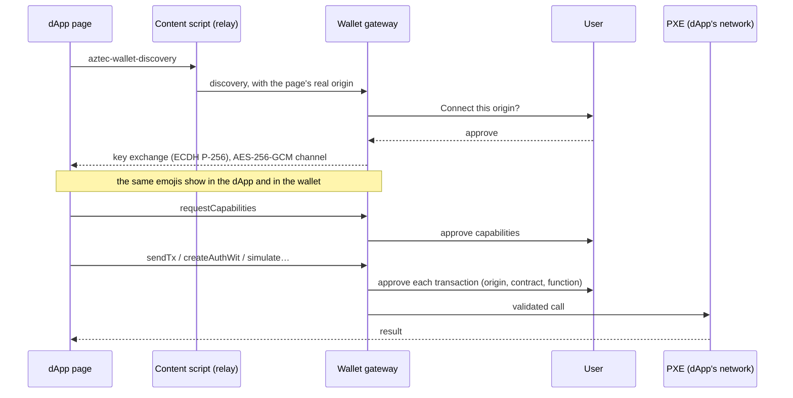

# dApp support

A wallet is only useful if dApps can use it: not only token transfers, but any contract call,
deployment or authorization. Azwall includes an **in-app dApp browser**, and dApps connect to it
through the standard Aztec **wallet-sdk extension protocol**, the one browser-extension wallets
implement. A dApp written for an extension wallet works in Azwall unchanged.

{: .note }
> On Android, the **Explore** section (from the menu) is a browser whose home page is Google. A test dApp
> connected through it on a Pixel 3, and a contract was deployed on testnet v6 from the page, proven
> natively in 15 s. iOS has the same browser (WKWebView): the content script and its `azwallBridge` run in a
> separate content world, out of reach of the page's own scripts.

Requests from the dApp appear in a **panel docked under the page**, not over it. The page stays usable:
it can be scrolled to read its emojis while the panel is open, and only the panel's buttons answer.
The panel collapses to its title and buttons to give the page back the screen. The emojis are compared
once, right after the key exchange; later requests do not repeat them.

Approved transactions land in the wallet's **activity** like its own: the gateway reports each one
(`dappTx` events: proving, sent with its hash, or failed), and the app follows the hash to a block. The
row shows what the transaction does (its first call) and the site that asked for it.

dApps register the contracts they call in the wallet's PXE, which keeps them. The wallet looks there for
**tokens the account holds but does not follow** (standard Token functions, non-zero balance) and suggests
them on the home screen: one tap follows a token, another dismisses it for good. This also finds tokens
from interactions made before the wallet recorded dApp activity; Aztec keeps no index of an account's
private transactions, so the history itself cannot be rebuilt.

## How a dApp connects

1. **Discovery.** The dApp broadcasts a discovery message. The wallet answers only after the user
   approves the connection for that origin.
2. **Secure channel.** The two sides run a key exchange, then show the same emojis so the user can
   check that nobody sits in between.
3. **Capabilities.** The dApp asks for what it needs. After that, it uses the wallet as an
   aztec.js `Wallet`.

## Safety

- **Every transaction is approved.** Each `sendTx` and each `createAuthWit`, also inside a batch, shows
  what will really run and waits for the user. A call names its function twice: a label the dApp
  chooses and a selector, which is what runs. The wallet looks the selector up in the contract's
  artifact, shows that function with its decoded arguments, and refuses a call whose label names
  another function. A call to a contract the wallet does not know is marked unverified.
- **A session belongs to one page.** The browser gives each page load a page id. A session and a
  pending connection answer only the page and origin that opened them; when the tab loads another
  page or closes, the gateway ends them and the app drops their pending requests. Another site
  cannot take over a connection approved for a site.
- **A session acts as one account.** The one selected when its capabilities were granted, even if
  the user switches account later. Calls cannot act as another account of the wallet, and the
  scopes they read are stripped of the other accounts. `getAddressBook` returns nothing, and methods
  the protocol does not need are refused.
- **Nothing before the emoji check.** Wallet messages wait until the user confirmed the emojis.
- **The origin comes from native code**, never from the page itself, and leads every request
  panel; what a page says about itself is shown as a claim below. A page can have one connection
  prompt open at a time, and messages over 1 MB are dropped.
- **Isolation.** The dApp runs in its own web view with no access to the wallet's code, files or
  keys. The content script injected into the page is a pure relay and holds no keys. Only HTTPS is
  allowed (plus `localhost` for development), and no other scheme leaves the browser.
- **Validation.** Arguments then go to the PXE, which validates them against Aztec's
  `WalletSchema`, as Aztec's own JSON-RPC server does.

## Several networks

A dApp states which network it targets (`chainInfo`). Azwall routes the session to the PXE of
that network's Aztec version. If the dApp targets an embedded network other than the selected
one, the wallet offers to switch. If it targets a network the app does not embed, the connection is
refused with a clear message.

## Proven in the prototype

A test dApp using the `PrivateVoting` contract ran end to end on the Aztec testnet, on a Pixel 3,
with every transaction proven natively by the wallet:

| Step | Pixel 3, native prover |
|---|---|
| Connect, emoji check, capabilities | ≈ 1 s after approvals |
| Deploy the contract | 28.9 s |
| `start_vote` (public) | 21.3 s |
| `cast_vote` (private, then public) | 22.8 s |
| A second vote from the same account | refused (nullifier already used) |
| `end_vote` (public) | 20.6 s |

## Still to do

- Enforce capabilities call by call (per contract and function), and keep grants beyond a session.
- Bookmarks and history in the dApp browser.
