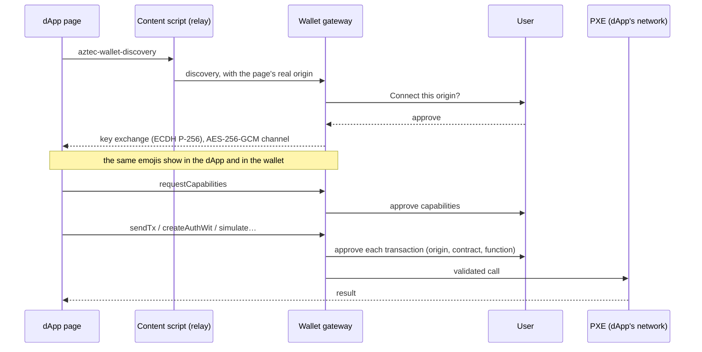

# dApp support

A wallet is only useful if dApps can use it: not only token transfers, but any contract call,
deployment or authorization. Azwall includes an **in-app dApp browser**, and dApps connect to it
through the standard Aztec **wallet-sdk extension protocol**, the one browser-extension wallets
implement. A dApp written for an extension wallet works in Azwall unchanged.

{: .note }
> The dApp browser below runs in the Tauri prototype and is being ported to the native apps.

## How a dApp connects

1. **Discovery.** The dApp broadcasts a discovery message. The wallet answers only after the user
   approves the connection for that origin.
2. **Secure channel.** The two sides run a key exchange, then show the same emojis so the user can
   check that nobody sits in between.
3. **Capabilities.** The dApp asks for what it needs. After that, it uses the wallet as an
   aztec.js `Wallet`.

## Safety

- **Every transaction is approved.** Each `sendTx`, each `createAuthWit`, and any batch containing
  one shows the origin and the calls (contract, function, kind) and waits for the user. Reads and
  simulations are allowed once capabilities are granted.
- **The origin comes from native code**, never from the page itself.
- **Isolation.** The dApp runs in its own web view with no access to the wallet's code, files or
  keys. The content script injected into the page is a pure relay and holds no keys. Navigation
  stays within the dApp's origin; only HTTPS is allowed (plus `localhost` for development).
- **Validation.** Arguments go untouched to the PXE, which validates them against Aztec's
  `WalletSchema`, as Aztec's own JSON-RPC server does.

## Several networks

A dApp states which network it targets (`chainInfo`). Azwall routes the session to the PXE of
that network's Aztec version. If the dApp targets an embedded network other than the selected
one, the wallet offers to switch. If it targets a network the app does not embed, the connection is
refused with a clear message.

## Proven in the prototype

A test dApp using the `PrivateVoting` contract ran end to end on the Aztec testnet, on a Pixel 3,
with every transaction proven natively by the wallet:

| Step | Pixel 3, native prover |
|---|---|
| Connect, emoji check, capabilities | ≈ 1 s after approvals |
| Deploy the contract | 28.9 s |
| `start_vote` (public) | 21.3 s |
| `cast_vote` (private, then public) | 22.8 s |
| A second vote from the same account | refused (nullifier already used) |
| `end_vote` (public) | 20.6 s |

## Still to do

- Enforce capabilities call by call (per contract and function), and keep grants beyond a session.
- Decode call arguments in approvals, not only function names and addresses.
- Tabs, bookmarks and history in the dApp browser.
