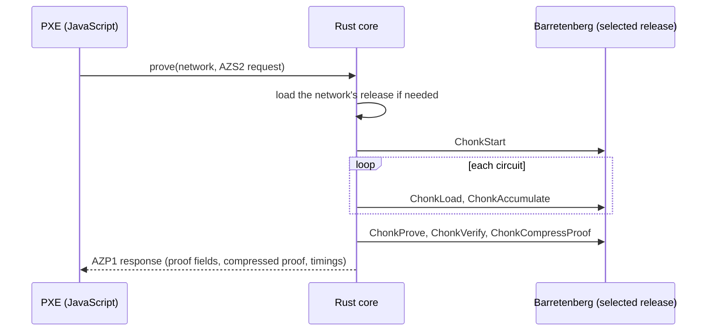

# Native proving

## Why

Every private Aztec transaction carries a client-side proof. The PXE executes the private
functions (account entrypoint, fee payment, the contract call), then the protocol's kernel
circuits, and folds all of them into a single **Chonk** proof (ClientIVC) with Barretenberg.

Aztec ships Barretenberg as WebAssembly (`bb.js`). In a mobile WebView, that is slow for a reason
that has nothing to do with WebAssembly itself: **Android WebView is never cross-origin
isolated**, so `SharedArrayBuffer` is unavailable and bb.js runs on a single thread. The prototype
tried every known workaround (COOP/COEP headers, HTTPS scheme, service worker). None of them
worked.

## Results

Private token transfer on the Aztec testnet, each transaction proven, accepted and mined.
Medians of 5 runs.

**Pixel 3** (2018, Snapdragon 845, 8 cores, 4 GB):

| | WebView, WASM, 1 thread | Chrome, WASM, 8 threads | **Native, 8 threads** |
|---|---|---|---|
| Chonk proof | 56.4 s | 19.1 s | **13.5 s** |
| Local total (tap → transaction accepted) | 66.5 s | 28.4 s | **24.5 s** |
| Peak memory | 973 MiB | 952 MiB | **458 MiB** |

**Alldocube iPlay 70 mini Pro** (tablet, MediaTek MT6877):

| | WebView, WASM, 1 thread | Chrome, WASM, 8 threads | **Native, 8 threads** |
|---|---|---|---|
| Chonk proof | 35.8 s | 16.5 s | **9.7 s** |
| Local total | 50.7 s | 34.5 s | **21.4 s** |
| Peak memory | 1069 MiB | 1203 MiB | **576 MiB** |

The native proof is **×4.2 faster** than the WebView on the Pixel 3 and uses half the memory. Most
of the gain comes from using every core. At equal thread count, native code is still about
×1.4 faster than WebAssembly. Further work in the prototype (a gas-limit cache, background note
sync) brought the Pixel 3 local total down to about 18 s.

## How

- **Same commands as bb.js.** The Rust core sends Barretenberg exactly the command sequence bb.js
  sends to its WebAssembly module, so the proof is the one Aztec's own prover would produce.
- **Verified before it leaves.** Every proof is verified natively before it is returned, as
  bb.js does.
- **Compact transport.** The request carries each circuit's bytecode and witness gzipped, as the
  PXE already holds them, in a small binary framing (`AZS2` in, `AZP1` out). For a private
  transfer that is about 1.5 MiB instead of tens of megabytes as JSON.
- **A dedicated thread.** Barretenberg keeps per-thread state and wants a large stack, so each
  release runs on its own prover thread, with the thread pool sized once per process.
- **Bundled CRS.** The proving setup files (about 20 MiB, universal for every release) ship in the
  app, so the first proof never waits for a download.

## What stays out of native code

The prototype also tried a native Noir ACVM for witness generation. It was correct, witness for
witness, but no faster: the time saved in solving was lost moving witness maps across the
boundary, and contract functions need a PXE callback per oracle call anyway. Witness generation
therefore stays in the PXE. That supports the [next design choice](pxe.md): only the expensive,
self-contained step (the proof) goes native.
