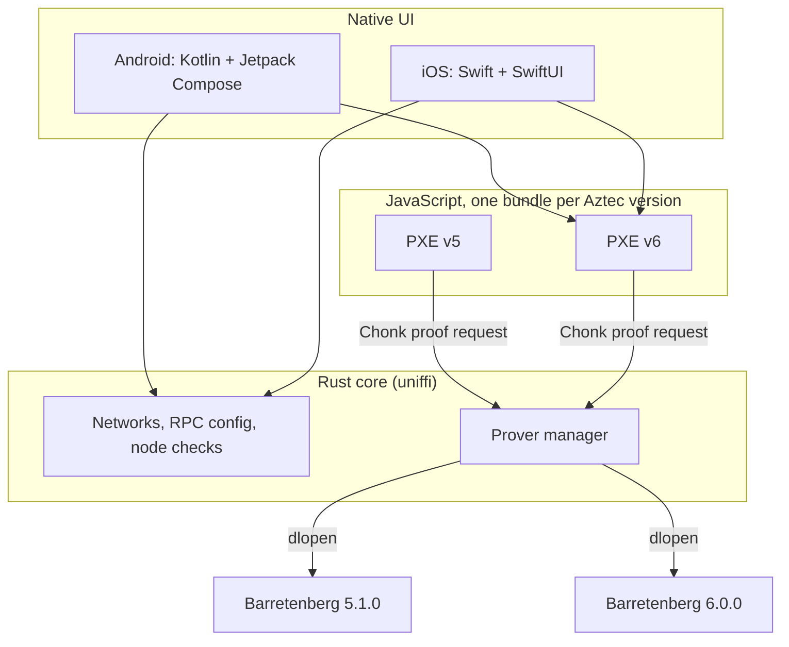

# Azwall

**A mobile wallet for Aztec, native on Android and iOS.**
{: .fs-6 .fw-300 }

Aztec is a privacy-first Layer 2 on Ethereum. Its private transactions are proven **on the
user's device**: the wallet executes the private functions, then builds a zero-knowledge proof
(a *Chonk* proof) before anything is sent to the network. On a phone, that proof is the hard
part. Azwall is built around making it fast, while keeping up with a protocol that still changes
from one release to the next.

## Four ideas

| | |
|---|---|
| **Every Aztec version, side by side** | Testnet v5, testnet v6, mainnet… run different, incompatible Aztec versions. Azwall embeds each one and picks the right one from the selected network. [More](design/multi-version.md) |
| **Native proving** | Proofs are made by Barretenberg compiled for the phone and run on every core, not by WebAssembly in a WebView. On a 2018 Pixel 3 the proof drops from 56 s to 13.5 s. [More](design/native-proving.md) |
| **The PXE stays in JavaScript** | The Private eXecution Environment (accounts, notes, sync, simulation) is Aztec's own TypeScript code. Keeping it means following each Aztec release by bumping a package, not by porting it. [More](design/pxe.md) |
| **dApps** | Web dApps written for an Aztec browser-extension wallet connect to Azwall unchanged, through the standard wallet-sdk protocol, with an approval for every transaction. [More](design/dapps.md) |

## How it is built

- **Native apps**, one per platform, for the UI, key storage and the dApp browser.
- **A Rust core** shared by both apps through [uniffi](https://mozilla.github.io/uniffi-rs/): the
  network registry, RPC configuration, node compatibility checks and the prover.
- **The PXE**, one JavaScript bundle per Aztec version, which hands its proofs to the Rust core.

## Status

Azwall follows a [Tauri prototype](https://github.com/youtpout/azwall-prototype) that answered
the open questions on real devices: native proving on Android, two Barretenberg releases in one
process, dApps over the wallet-sdk protocol. Every transaction measured there was proven,
accepted and mined on the Aztec testnet.

| Part | State |
|---|---|
| Rust core: networks, `.env` RPC config, node checks | Done, tested against both testnets |
| Multi-release prover (Barretenberg 5.1.0 and 6.0.0) | Done; proven on device in the prototype |
| Android app (Kotlin, Compose) | Scaffold: network selection, node check, prover loading |
| iOS app (Swift, SwiftUI) | Scaffold; Barretenberg not yet built for iOS |
| PXE in a headless JS runtime | Next step |
| Key storage, dApp browser | Done in the prototype, to port |

Next: [the design](design/), [the architecture](architecture.md), or [how to build it](development.md).
